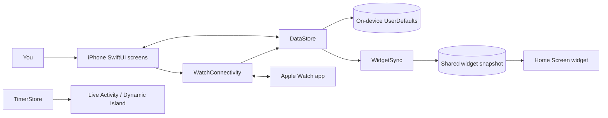
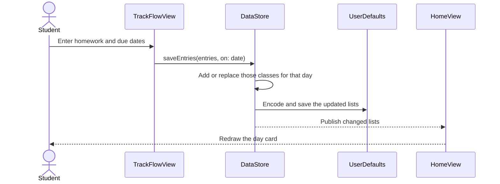
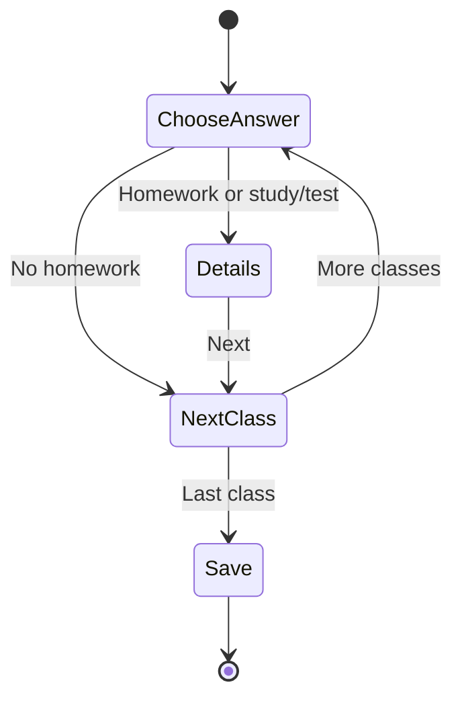
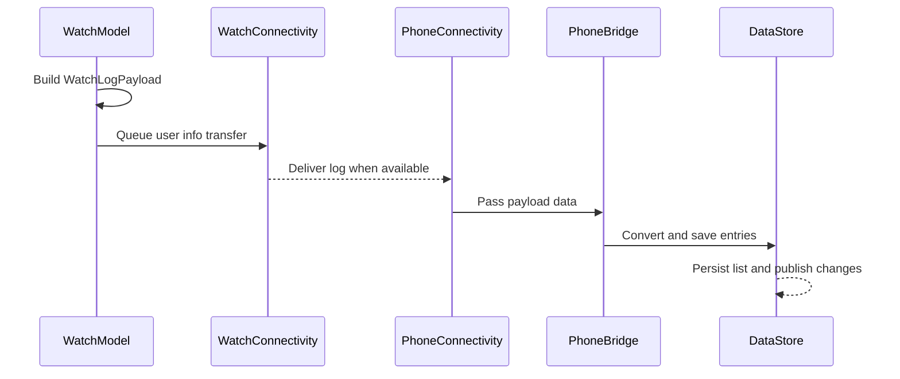

# How ClassList Is Built

This guide explains the ClassList app for someone who knows Swift but is new to iOS. It describes the current code, not an idealized version of how every iOS app should be built. Think of it as a map you can keep open while exploring the project in Xcode.

## 1. The big picture

ClassList is made from a few cooperating programs:

- **The iPhone app** shows the screens and owns the main class, schedule, day-list, and study-log data.
- **The widget extension** draws a small summary for the Home Screen and a Live Activity for the timer.
- **The Apple Watch app** lets you record work with taps and sends those answers back to the iPhone.

The iPhone app is the main hub. It saves its data locally, prepares a smaller snapshot for the widget, and sends a class list to the watch.



The diagram shows the intended direction of information. In the source code, separate Swift types do each job; the boxes are not necessarily separate servers or devices. `UserDefaults` and the shared widget snapshot are local storage, while WatchConnectivity moves messages between the paired iPhone and watch.

## 2. How an iOS app starts

The iPhone app starts at `ClassList/ClassList_AllFiles/1_App_files/ClassListApp.swift`:

```swift
@main
struct ClassListApp: App {
    @StateObject private var store = DataStore()
    @StateObject private var timerStore = TimerStore()
    // ...
}
```

- `@main` tells Swift where the app begins.
- `App` is SwiftUI's app-level type. It describes the app's scenes and first screen.
- `WindowGroup` creates the app's main window. On iPhone, that is usually one active window.
- `@StateObject` creates and owns an observable object for as long as this part of the app lives.
- `.environmentObject(...)` makes those objects available to child views without passing them through every initializer.

`RootView` decides whether to show `SetupView` or the main navigation stack. If no classes are saved, the user sees setup. Otherwise, the home screen is shown.

The `@UIApplicationDelegateAdaptor` line connects SwiftUI to an older iOS app-startup hook. Here, `AppDelegate` installs the notification delegate and starts the phone side of WatchConnectivity early in launch.

## 3. SwiftUI: describing a screen

In UIKit, a programmer often tells the system directly: “create this label, move it here, and update it now.” SwiftUI is more declarative. A `View` describes what the screen should look like for the current state. When state changes, SwiftUI recalculates the view description and updates what is visible.

For example, `RootView` checks whether `store.classes` is empty. If a user finishes setup, `DataStore` changes, SwiftUI notices the published change, and the root can show the home screen.

Useful SwiftUI wrappers in this app:

| Code | Beginner description | ClassList example |
| --- | --- | --- |
| `@State` | Small, temporary state owned by one view. | The selected step or navigation path. |
| `@Binding` | A two-way connection to state owned somewhere else. | A child screen changing a parent's navigation path or a selected date. |
| `@Published` | Marks an object property so observers are notified when it changes. | `DataStore.classes`, `DataStore.lists`, and `TimerStore.session`. |
| `ObservableObject` | A reference-type object that can publish changes. | `DataStore` and `TimerStore`. |
| `@StateObject` | An observable object this view creates and owns. | `ClassListApp` creates the shared stores. |
| `@EnvironmentObject` | Reads an observable object supplied by an ancestor. | Screens read `DataStore` without receiving it in every initializer. |

An important idea: **state is the information; a view is its visible representation.** For example, checking an assignment changes the model. The checkmark is redrawn from that changed model.

## 4. The main data model and storage

The core types live in `Models.swift`:

```text
SchoolClass
  └─ ClassEntry for one date
       └─ Assignment(s)

DayList for one date
  └─ ClassEntry for each class recorded that day

SavedSchedule
  └─ ScheduleSlot(s): class + weekday + start/end time

StudyLog
  └─ time spent studying and on breaks
```

These are `struct` values, so changing one usually means making an updated copy and assigning it back into the array or property that owns it. IDs are UUIDs: unique tags that let the app find the same class or assignment even if its display name changes.

`DataStore` is the main source of truth for class and schoolwork data. It is an `ObservableObject` marked `@MainActor`. In plain language, `@MainActor` means its UI-facing changes are expected to happen on the main thread—the thread iOS uses to update the screen.

When a saved property changes, its `didSet` calls `save`. The store encodes the value as JSON data, then saves that data under a key in `UserDefaults`. On startup, it reads the data and decodes it back into Swift values.



`UserDefaults` is simple local key/value storage and fits this app's current small collections. It is not a database server and does not automatically sync between devices. In this project, the iPhone and watch have separate local stores; only the specific class and log messages are transferred between them. The app does not currently use CloudKit for general data sync.

## 5. Navigation and the daily logging flow

`Route` in `ClassListApp.swift` is an enum that lists the kinds of screens the app can navigate to: a log flow, a day list, settings, schedule, or timer. The `NavigationStack` holds a `path`, which is like a stack of visited screens. `navigationDestination` maps each route to the correct view.

This approach keeps navigation choices visible in one place. For example, `.timer(classID)` means “show the timer screen for this class.” The UUID identifies the class without relying on a name that might change.

The daily logging process in `TrackFlowView` is a small state machine. A **state machine** is a set of named steps and rules for moving between them:



The answers are first stored in the view's temporary `@State` drafts. They are not saved as the permanent day list until the user finishes. Then `finish()` builds `ClassEntry` and `Assignment` values and calls `store.saveEntries`. That separation is useful: the app can let someone edit the answers while they are in the flow, and only commit the finished result at the end.

## 6. The timer, background work, and system features

`TimerStore` owns one current `TimerSession`. It saves that session in `UserDefaults`, so closing the app does not lose the start time or accumulated time. The timer calculates elapsed time from real `Date` values rather than trusting a counter that ticks once each second. That matters because iOS may pause or suspend an app when it is in the background.

When a session changes, `TimerStore` asks `LiveActivityManager` to update the ActivityKit Live Activity. It also schedules or cancels a local notification for a countdown. When a timer is finished, its study and break duration is added to `DataStore.studyLogs`.

Other iOS concepts you can see here:

- **Local notifications** are alerts scheduled on the device. Class reminders are refreshed for the next seven days. Tapping one creates a `PendingAction`; `RootView` turns that into a navigation route.
- **Scene phase** (`scenePhase`) tells the app whether its UI is active, in the background, or inactive. `RootView` refreshes reminders, widgets, and other state when the app becomes active again.
- **ActivityKit** powers the timer display on the Lock Screen and Dynamic Island. The system renders the Live Activity, so it can keep showing a timer while the app itself is not open.
- **WidgetKit** runs the widget extension separately from the iPhone app. The app writes a compact `WidgetSnapshot`; the widget reads it and supplies a timeline entry. `WidgetCenter` is asked to reload when app data changes, but iOS controls exactly when widgets refresh.
- **App Groups and entitlements** are the permission/configuration that let two app targets share a container. `SharedSnapshotStore` derives a suite name from the app's bundle ID; with the current bundle IDs, it uses `group.com.ClassList26`. The checked-in project does not include an entitlements file or an App Groups capability, so verify that both the iPhone and widget targets have that matching App Group configured in Xcode signing settings. Without that shared-container setup, the widget may not be able to read the phone app's snapshot.
- **Vision** recognizes text in a selected schedule photo. The app turns recognized text into possible schedule entries and lets the user review/import them.

These features ask iOS to do work on behalf of the app. They have their own lifecycle and rules, so they do not behave exactly like another screen in the main app.

## 7. How the Apple Watch talks to the iPhone

`WatchPayload.swift` defines small `Codable` structs that both targets can understand. `Codable` is Swift's way of converting a value to and from a format such as JSON. The iPhone sends a list of `WatchClass` values as application context; the watch can save the latest list locally and show it even when it is not actively receiving a message.

When the student finishes logging on the watch:

1. `WatchModel` encodes a `WatchLogPayload` and queues it with `transferUserInfo`.
2. `PhoneConnectivity`, the iPhone's `WCSessionDelegate`, receives the message.
3. `PhoneBridge` matches each class UUID to the current `DataStore` and creates entries.
4. `DataStore.saveEntries` merges those class entries into that day's list and saves it.



WatchConnectivity is asynchronous: a queued message may arrive later, not in the same instant the student taps Send. If the iPhone has not attached its store yet, `PhoneBridge` temporarily keeps the message in `UserDefaults` and applies it when the app opens. The phone and watch are not sharing one live memory space; they send encoded copies of data.

## 8. Xcode: project, targets, and schemes

The `.xcodeproj` file is a recipe Xcode uses to organize source files, assets, and build settings.

- A **project** is the overall workspace configuration.
- A **target** is one thing Xcode builds. This project has an iPhone app target, a widget extension target, and a watch app target.
- A **scheme** tells Xcode which target(s) to build and run, and with which configuration.
- The **simulator** runs a built app in a simulated device environment. Some features, such as paired watch communication and notifications, may need additional simulator setup or real devices to fully exercise.
- The yellow/blue groups and folders in Xcode's navigator help organize files. A displayed group name does not by itself decide which target compiles a Swift file; target membership and the project configuration do that.

Open `ClassList/ClassList.xcodeproj` and select the `ClassList` scheme to build and run the iPhone app. The widget and watch code are built as their own targets and embedded/paired with the iPhone app according to the project configuration.

## 9. Architecture habits to learn from this project

Good architecture is mostly about making responsibilities understandable and changes safe. ClassList already demonstrates several useful ideas:

- **One source of truth:** screens read and change shared class/list state through `DataStore`, instead of each screen keeping a separate copy of permanent data.
- **Small models:** `SchoolClass`, `Assignment`, and `DayList` describe the app's data without being screen layouts.
- **Clear boundaries:** widget rendering, watch communication, notifications, schedule import, and timer behavior have dedicated types/files.
- **Stable identifiers:** UUIDs connect assignments, classes, and schedules without using mutable display names as keys.
- **Temporary drafts before saving:** the logging flow lets the user finish a multi-step task before writing the final entries.

As the app grows, useful next steps to study are:

1. Add unit tests for rules in `DataStore`, such as merging entries and switching schedules.
2. Replace silent `try?` persistence failures with error handling or logging, so corrupted data is easier to diagnose.
3. Keep feature files focused; some current files contain many views and could later be split by feature.
4. Consider a database such as SwiftData if data becomes large or needs richer queries and migrations. `UserDefaults` is appropriate for modest local data, but has limits.
5. Decide deliberately whether the app should sync all data across devices. WatchConnectivity currently transfers a class list and watch logs; it is not a general cloud-sync system.

These are learning directions, not prerequisites for understanding the current app.

## 10. A good reading order in the code

1. `ClassList/ClassList_AllFiles/1_App_files/ClassListApp.swift` — app startup, shared stores, and routes.
2. `ClassList/ClassList_AllFiles/1_App_files/Models.swift` — data shapes and save/load behavior.
3. `ClassList/ClassList_AllFiles/1_App_files/SetupAndHomeViews.swift` — setup and the main screen.
4. `ClassList/ClassList_AllFiles/1_App_files/TrackFlowView.swift` — a complete user action from answers to saved data.
5. `ClassList/ClassList_AllFiles/1_App_files/TimerFeature.swift` — a feature connected to app storage and system APIs.
6. `ClassList/ClassList_AllFiles/1_App_files/PhoneConnectivity.swift` and `ClassList/ClassListWatch Watch App/3_Watch_files/WatchModel.swift` — messages between targets.
7. `ClassList/ClassList_AllFiles/1_App_files/WidgetSync.swift` and `ClassList/ClassListWidgets/ClassListHomeWidget.swift` — how the app prepares data for a widget.

When reading a feature, ask: **Who owns this state? What action changes it? Where is it saved? Who else needs to hear about the change?** Those four questions reveal most of the architecture.
